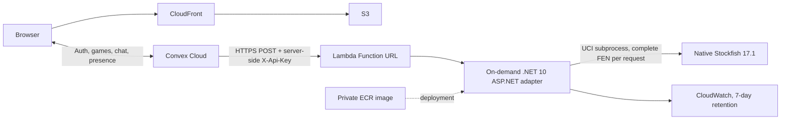

# On-demand Stockfish engine on AWS Lambda

Deployment status (2026-10-10 UTC): the .NET 10 + native Stockfish Lambda replacement is deployed in account `058264467102`, us-east-1. Production Convex now uses its Function URL. Native cold/warm requests, concurrent requests, timed production computer games, human multiplayer, private chat, password sign-in, and presence passed. The dedicated `chess-lobby-engine` Lightsail container service was deleted and its absence verified. Existing S3/CloudFront/DNS hosting is unchanged. Local Docker Desktop work is stopped; Linux image builds and validation ran in GitHub CI, and deployment used connected AWS access.

Function URL: `https://4epw473km3adiseigmyve5oggm0utkkp.lambda-url.us-east-1.on.aws/`. The active image is `sha256:348f319bc57e1549fa156942042a5a5ae412c1b1dc100a8679432c192ef9d0e7`, built from runtime source `fe578d8` in validated CI run `38012716147`; its real AWS endpoint suite passed after deployment. `keep-rollback` retains the initial verified cutover image `sha256:7a87fda0270d7be896d625174306e8b1653e739b82301c326197ccb86b64a945` (CI `38010891434`). The function stack's `ImageUri` parameter and ECR `release-*` tags record deployments. Failed startup candidates and unused documentation-only builds were removed. `keep-current` protects the active validated release.

## Architecture and resources



Only the vs-computer endpoint moves. S3, CloudFront, Route 53, HTTPS, Convex authentication, database, realtime multiplayer, chat, and presence retain their existing deployment. Stockfish still searches on the server and retains skill levels 0–20; the existing game UI's difficulty values continue working.

Two small CloudFormation stacks in `infra/engine-lambda` create these resources in **us-east-1**:

| Stack | Resource | Configuration |
| --- | --- | --- |
| `chess-lobby-engine-lambda-ecr` | Private ECR repository | AES256 encryption, basic scan on push, immutable `release-*` tags; only `keep-*` pins are mutable |
| ECR stack | Repository policy | Lambda service may pull only for this account/region's `chess-lobby-engine-*` functions |
| ECR stack | Lifecycle policy | Protect two rotating current/rollback pins, retain three recent release candidates, expire untagged images after one day |
| ECR stack | Image-publisher IAM role and managed policy | GitHub OIDC trust restricted to this repository's PRs; image upload/read permissions on this ECR repository only, without Lambda or website access |
| `chess-lobby-engine-lambda` | Lambda function | Image pinned by digest, x86_64, 2,048 MiB memory, 512 MiB temporary storage, 30-second timeout, reserved concurrency 2 |
| Function stack | Function URL | Buffered HTTP API v2 payloads, HTTPS, `AuthType: NONE`, no CORS configuration |
| Function stack | Two Lambda resource permissions | Public Function URL invocation; underlying `InvokeFunction` grant restricted to URL calls |
| Function stack | Execution IAM role | Trusts Lambda; attached policy permits only creating streams and writing events in the engine log group |
| Function stack | IAM managed policy | Scoped CloudWatch logging permissions; no AWS database, secret-store, or network permissions |
| Function stack | CloudWatch log group | Seven-day retention; retained when its stack is deleted |

There is no provisioned concurrency, keepalive schedule, VPC, NAT gateway, load balancer, or idle server. Reserved concurrency **caps** concurrent work; it does not keep environments running. Account-wide concurrency quotas must leave room for AWS's required unreserved capacity; a very low new-account quota can block a reservation.

## Authentication and work limits

Convex's server-side `fetch` supplies the existing `X-Api-Key` header. `AWS_IAM` would require signed requests and AWS credentials inside Convex; this implementation uses an application key to preserve the current integration. AWS describes both required permissions for `NONE` Function URLs in its [Function URL access documentation](https://docs.aws.amazon.com/lambda/latest/dg/urls-auth.html).

Generate a random key or reuse the existing Lightsail key if it is sufficiently strong and at least 32 characters. Keep it in a password manager, Lambda configuration, the deployment runner's environment, and Convex's server environment. Never set a `VITE_*` variable for it. CloudFormation receives a constrained `NoEcho` parameter through a temporary file that is removed in `finally`; it is absent from templates, image layers, outputs, and shell arguments. Lambda encrypts environment variables at rest. Principals allowed to read/decrypt Lambda configuration can still access the key; `NoEcho` is not a secret vault.

The app requires a configured key at startup and compares hashes in constant time **before** parsing a move request or starting Stockfish. `/health` remains a lightweight public liveness endpoint; it does not start Stockfish. No permissive browser CORS policy is enabled. An invalid-key request can still invoke Lambda and incur a small charge: the key prevents engine access, and concurrency bounds simultaneous work, but neither is an absolute spending limit. If needed, stop all work by setting reserved concurrency to zero.

- Request body limit: 4 KiB, including under the Lambda adapter.
- FEN: six fields, structurally valid board with one king per side, no adjacent kings or pawns on promotion ranks, no newlines/UCI injection. Convex remains the legal-position authority.
- Stockfish: one thread, 32 MiB hash, skill clamped to 0–20, thinking time clamped to 100–1,500 ms. Existing requests still ask for 800 ms.
- App deadline: twenty-five seconds, with a twenty-two-second native initialization allowance and a separate five-second UCI/search deadline once ready, still subject to the total app deadline. Failed/cancelled searches kill the subprocess; EOF is an error, not a busy loop. Next request starts a clean process.
- Lambda deadline: thirty seconds. Convex fetch deadline: thirty-five seconds including cold-start headroom. Error responses avoid exposing process details. Slow cold starts can trigger the existing timed-game first-move grace period, so verify timed gameplay before cutover.
- Every request issues `ucinewgame` and a complete FEN. Warm environments reuse the native process without sharing another game's position. There is no requirement to keep a particular environment alive.

The HTTP contract stays `POST /api/best-move` with `{ "fen": "...", "skill": 10, "movetimeMs": 800 }` and `{ "bestMove": "e7e5" }`. Convex now trims trailing slashes, bounds the fetch, and checks that external output is a legal move before applying it. The existing minimax fallback remains available for timeouts, throttling, bad output, and service failures.

## Runtime and Stockfish packaging

The ASP.NET app uses `Amazon.Lambda.AspNetCoreServer.Hosting` with `LambdaEventSource.HttpApi`; the handler is the assembly name `ChessEngine`. The same application still runs with Kestrel locally or in the ordinary HTTP Dockerfile. The Lambda image uses AWS's .NET 10 Amazon Linux 2023 base. [.NET 8 and 9 base images deprecate November 10, 2026; .NET 10 is listed through November 14, 2028](https://docs.aws.amazon.com/lambda/latest/dg/csharp-image.html), so this new deployment targets .NET 10. Container runtimes are updated by rebuilding and deploying a new image, not by leaving an old digest indefinitely.

`Dockerfile.lambda` compiles Stockfish 17.1 from commit `03e27488f3d21d8ff4dbf3065603afa21dbd0ef3` on Amazon Linux 2023 using portable `ARCH=x86-64`. It does not assume AVX2/BMI2 instructions or use an Ubuntu binary with different native dependencies. The final runtime installs `libstdc++`. Build and deployment explicitly select `linux/amd64` and disable Buildx provenance to produce a single-architecture Lambda-compatible image.

Stockfish is GPLv3. The image includes its license, exact source archive, and the two NNUE files used for compilation under `/opt/licenses/stockfish`. The documented build command, source commit, and build scripts provide reproducible corresponding-source context. If distributing the image/binary, distribute that corresponding source and license with it. See [Stockfish's repository](https://github.com/official-stockfish/Stockfish) and `Copying.txt`. To extract the bundle for distribution:

```powershell
docker create --name chess-engine-license chess-engine-lambda:test
docker cp chess-engine-license:/opt/licenses/stockfish ./stockfish-source.local
docker rm chess-engine-license
```

## Validation before deployment

Requirements: Node 22+, .NET 10 SDK, AWS CLI v2, PowerShell 7 for CI, Docker with a running Linux engine. Do not run Docker commands until its desktop issue is deliberately resolved; GitHub's Linux runner can perform the container checks independently.

```powershell
npm ci
dotnet test tests/ChessEngine.Tests/ChessEngine.Tests.csproj -c Release
node --experimental-strip-types --test tests/computer-engine.test.mjs
pwsh -NoProfile -File tests/deploy-engine-lambda.tests.ps1
npx tsc --noEmit -p convex/tsconfig.json
npm run build:web
```

The PowerShell test harness mocks every AWS, Docker, and Node command: it verifies deployment sequencing, secret/template-file cleanup, no-op updates, promotion only after smoke checks, automatic restoration and validation after candidate failure, explicit rollback-validation failure, initial-deployment failure, and the absence of Convex cutover/retirement actions. It creates no resources and starts no Docker processes.

Docker-free native/adapter check, with a Stockfish binary for the local OS:

```powershell
dotnet publish apps/chess-engine/ChessEngine.csproj -c Release -o engine-publish.local
$env:STOCKFISH_PATH = 'C:/absolute/path/stockfish.exe'
node scripts/test-engine-runtime.mjs --assembly engine-publish.local/ChessEngine.dll
```

This starts the actual .NET Lambda runtime client against a local Runtime API stub and tests Function URL-shaped events with native Stockfish. It does not prove the Linux image works. Local results on Windows: 12 .NET tests passed, the Linux subprocess fixture skipped; six Convex integration tests passed; native adapter check passed legal moves, skill extremes, search clamping, authentication, malformed/oversized input, mate-in-one, and a 12-ply game sequence. First request was approximately 1,690 ms and warm request 810 ms on this machine, including 800 ms requested search. These are not AWS cold-start or billed-duration measurements. Web build and Convex TypeScript checks passed. Both templates passed AWS IaC MCP schema and bundled security validation with no findings.

Linux CI passed all thirteen .NET tests, including the real subprocess cancellation/exit fixture, and built the image successfully. The image is **567.4 MiB uncompressed**. The Runtime Interface Emulator check passed read-only/unprivileged operation, native architecture, crash recovery, pause/resume, source packaging, and all request/move tests. First/warm requests were approximately **1,465/811 ms on the GitHub runner**, not AWS cold-start measurements. Web and Convex CI checks also passed. After adding the ECR publisher role, generic security validation reports one wildcard-resource finding: `ecr:GetAuthorizationToken` requires `Resource: '*'` by AWS design. It is limited to us-east-1 and all effective image permissions are repository-scoped. This is a documented exception, not an additional broad runtime grant.

Repeat the Linux check in CI or once a Linux Docker environment is available:

```powershell
docker buildx build --platform linux/amd64 --provenance=false --load -f apps/chess-engine/Dockerfile.lambda -t chess-engine-lambda:test .
node scripts/test-engine-lambda.mjs --image chess-engine-lambda:test
```

The container test uses AWS's Runtime Interface Emulator with the actual native binary, an unprivileged user, read-only root, writable `/tmp`, and 2 GiB memory. It additionally tests process crash recovery, pause/resume, architecture, source packaging, and reports uncompressed image size. The Linux .NET fixture checks cancellation/exit recovery and that UCI receives search/thread/hash limits. CI runs both checks and `cfn-lint` on each PR.

## Deploy the replacement without cutting over

Authenticate using the project's `shawnmdev` AWS profile, then verify:

```powershell
aws sts get-caller-identity --profile shawnmdev --region us-east-1
```

The deployer needs CloudFormation change-set/create/update/read/wait permissions for the two engine stacks; ECR create/configure/lifecycle/policy/tag/push/read permissions for the engine repository; Lambda create/update/read/delete/URL/permission/concurrency operations on the named function; CloudWatch log-group create/read/retention/tag permissions for its log group; and IAM role/managed-policy create/read/update/delete/attach/tag permissions for the generated engine role/policy plus `iam:PassRole` limited to that role and `lambda.amazonaws.com`. ECR `GetAuthorizationToken` requires `Resource: *`. The runtime role itself only has logging permissions. Do not use an administrator runtime role.

The default stack/function name must begin `chess-lobby-engine-` to match the repository pull policy. Templates are deliberately restricted to us-east-1. Secrets in these snippets are placeholders; capture existing key values into variables without printing them.

```powershell
# Prefer reusing the current strong production key to simplify rollback.
$env:ENGINE_API_KEY = 'your-existing-strong-key-from-secure-storage'
./scripts/deploy-engine-lambda.ps1 -Profile shawnmdev
```

The script checks identity, builds and validates the Linux image before creating resources, deploys the repository stack, pushes a unique immutable release tag, and resolves the image digest. Before updating an existing function it saves the deployed image and infrastructure template, protects the deployed image from cleanup, and preserves the existing key and capacity parameters with `UsePreviousValue`. Supply the existing key for endpoint validation; key rotation is a separate operation. If the stack update or AWS smoke test fails, it restores the prior image and template and smoke-tests the restored endpoint before reporting failure. An AWS-only failure can briefly affect the stable production URL during validation/rollback. Failed candidates are never promoted to `keep-current`; an initial deployment has no prior release to restore. Successful smoke checks precede rotation of `keep-current`/`keep-rollback`. The script prints the validated URL, digest, and ECR **compressed** size, and never invokes Convex or Lightsail commands. Both stacks passed account-specific change-set review and deployment. Connected-AWS deployment and real endpoint checks passed; the local CLI script, including rollback behavior, has mocked coverage because local CLI credentials and Docker were unavailable.

On failure, inspect the specific operation and validation events before retrying:

```powershell
aws cloudformation describe-events --stack-name chess-lobby-engine-lambda --filters FailedEvents=true --profile shawnmdev --region us-east-1
```

The new **Deploy engine Lambda** GitHub workflow calls the same script and is manual, independent of the website/Convex workflow. Set up the `engine-lambda` GitHub environment with `ENGINE_AWS_ROLE_ARN` and `ENGINE_API_KEY`. Configure the deployment role's OIDC trust for `repo:OWNER/REPO:environment:engine-lambda`, audience `sts.amazonaws.com`, and the permissions above. Optional environment reviewers can gate deployment. Workflow concurrency serializes releases; it never cuts production over.

For deployment through the connected AWS MCP without local Docker/CLI credentials, the ECR stack also creates an **ECR-only image publisher** role. Set the repository variable `ENGINE_IMAGE_ROLE_ARN` to the `ImagePublisherRoleArn` stack output and `ENGINE_ECR_REPOSITORY` to the repository name. The engine PR CI job publishes its image only after tests pass, only for PRs originating inside this repository, and uses a unique release tag. This role cannot deploy Lambda, read engine keys, change IAM, or access the existing website. A separately authenticated CloudFormation caller deploys the function from the validated digest and may reuse the existing Lightsail key server-side without displaying it or putting it into CI. The publisher's OIDC trust assumes the existing GitHub OIDC provider from the website stack.

## Cutover, gameplay verification, and rollback

1. Keep Lightsail running. Record the existing production engine URL and key in secure storage. Deploy Lambda and pass its direct endpoint smoke test.
2. Deploy the small Convex fetch improvements with the existing Convex deployment workflow. They also work with Lightsail, so this can occur before cutover.
3. Capture the printed Function URL and test it again with the production key:

   ```powershell
   $env:ENGINE_API_URL = 'https://your-function.lambda-url.us-east-1.on.aws'
   node scripts/test-engine-lambda.mjs --url $env:ENGINE_API_URL
   ```

4. After those checks pass and cutover is approved, set the production Convex variables using `scripts/setup-convex-engine.ps1`. Reusing the existing key avoids a mismatch during sequential environment updates. If rotating keys, preserve both old values securely for rollback.
5. Play a production computer game at low and high difficulty, including several moves from an idle start, and confirm no fallback/error logs. Test a human multiplayer match and chat. Direct Lambda tests alone do not prove production is using Stockfish because Convex can fall back silently.
6. Inspect Lambda's CloudWatch `REPORT` records for init duration, billed duration, maximum memory, and errors; record ECR compressed storage. Repeat after an idle interval and a simultaneous second game. Verify that cold starts remain acceptable.
7. Keep the old service available through verification. Only after approval of the completed cutover and rollback evidence should Lightsail be retired.

Rollback **before** retirement: restore the recorded old URL and old key via `scripts/setup-convex-engine.ps1`; verify another game. Leave Lambda for investigation. For an image rollback, change CloudFormation's `ImageUri` to the previous digest protected by `keep-rollback`, preserve `EngineApiKey`, and deploy the stack through a change set. A direct `update-function-code` would create stack drift; reconcile any emergency update afterward.

Emergency stop of Lambda (does not affect multiplayer; vs-computer falls back):

```powershell
aws lambda put-function-concurrency --function-name chess-lobby-engine-lambda --reserved-concurrent-executions 0 --profile shawnmdev --region us-east-1
```

Restore concurrency to 2 when appropriate, and reconcile the CloudFormation `ReservedConcurrency` parameter if changed outside the stack.

Retirement is intentionally a separate operator action. Review and securely record the Lightsail image/deployment configuration, endpoint, key, service name, power and scale; make sure the image/source remains available to rebuild it. Stopping/disabling service alone does not establish that the fixed service charge has ended. Once the new production game path is verified and retirement is approved:

```powershell
# Destructive: run only after the verified/approved cutover, never as part of deployment.
aws lightsail delete-container-service --service-name chess-lobby-engine --profile shawnmdev --region us-east-1
```

Confirm the service has been removed and check later billing. After deletion, rollback to Lightsail requires recreating it from the saved configuration; the old endpoint may change. The deployment script never performs this command. To remove the Lambda replacement, delete its function stack; its log group and ECR repository are retained and must be reviewed separately if full cleanup is desired.

## Deployed measurements and monthly savings

AWS `REPORT` records separate handler and initialization time from billed duration:

| Request | .NET init | Native initialization | Handler duration | Billed duration |
|---|---:|---:|---:|---:|
| Cold development Convex → Lambda game | 995.19 ms | 13,403 ms | 14,463.36 ms | 15,459 ms |
| Second cold direct endpoint check | 903.53 ms | Included in handler | 5,099.48 ms | 6,004 ms |
| Final cold production game | 851.98 ms | Included in handler | 2,074.92 ms | 2,927 ms |
| Cold endpoint after review fixes | 657.23 ms | 991 ms | 2,056.92 ms | 2,715 ms |
| Representative warm 800 ms search | — | Reused process | 814.25 ms | 815 ms |

Cold startup varied across environments. Earlier five- and twelve-second initialization limits timed out, so the final deployment allows 22 seconds for native initialization within a 25-second app deadline, followed by a 30-second Lambda deadline and a 35-second Convex fetch deadline. Search remains capped at 1.5 seconds. The cold development game finished in about 16.5 seconds and the final cold production game in about 3.5 seconds, both within the existing timed-game first-move grace period and with no fallback. Six additional production computer replies at skills 1 and 20 passed concurrently with no fallback. Maximum observed memory was 383 MiB. Temporary verification functions, games, messages, and auth records were removed afterward.

The retired service was verified through `GetContainerServicePowers`: **Micro × 1, $10/month maximum**. Cost Explorer reported **$9.6774192 for 720 hours in September 2026** for the matching us-east-1 container usage type, excluding credits/refunds. Another account Lightsail instance in us-west-2 belongs to a separate workload and is excluded from these Chess savings. October accrued usage remains payable; deleting the service stops future container-service charges, as described in [Lightsail billing documentation](https://docs.aws.amazon.com/lightsail/latest/userguide/amazon-lightsail-faq-containers.html).

Retained compressed storage was calculated from unique manifest layer/config descriptors, avoiding image-index double counting:

| Repository | Purpose | Compressed bytes | Estimated storage/month |
|---|---|---:|---:|
| `chess-lobby-engine-lambda-ecr-images` | Current verified Lambda image plus verified rollback | 718,983,404 | $0.06696 |
| `chess-engine` | Original Lightsail image for recreation | 117,120,017 | $0.01091 |
| Total | Active engine, Lambda rollback, and old image | 836,103,421 (0.77868 GiB) | $0.07787 |

The 567.4 MiB uncompressed Docker image size is not the ECR billing size. ECR cleanup may take up to 24 hours. Subsequent retained release candidates and rollback images increase storage; remeasure all retained unique layers after deployments. Rates used: [Lambda](https://aws.amazon.com/lambda/pricing/) $0.0000166667/GB-second and $0.20/million requests; [ECR](https://aws.amazon.com/ecr/pricing/) $0.10/GB-month; [CloudWatch](https://aws.amazon.com/cloudwatch/pricing/) $0.50/GB ingested and $0.03/GB archived, with seven-day retention.

Light-traffic estimate: one game per visitor, 60 computer replies per game, one 15.459-second cold invocation per game and 59 warm invocations at 0.815 seconds, 2 GiB memory. Compact logs are estimated at 600 bytes per request plus cold-start diagnostics.

| Visitors/games per month | Lambda compute + requests | Estimated logs | Total ECR storage | Engine total/month |
|---:|---:|---:|---:|---:|
| 1 | $0.00213 | $0.00002 | $0.07787 | **$0.08002** |
| 10 | $0.02130 | $0.00017 | $0.07787 | **$0.09934** |

Idle compute/request cost is zero; ECR storage remains recurring. Compared with the recent 30-day charge and the $10 plan maximum, expected net savings are approximately **$9.59–$9.93/month** at this traffic, after subtracting the added Lambda/storage/log costs. The old image storage existed before migration, so it is shown in the engine total but is not treated as a new migration charge. Even the conservative scenario of 600 invocations all billed at 15.459 seconds costs under $0.39/month including the current retained storage and estimated logs. These estimates precede free allowances/credits, exclude data transfer and existing site/Convex/DNS/domain costs, and are not actual future bills. Remaining shared-account free allowances were not verified.

Reproduce or vary the measured scenario:

```powershell
node scripts/estimate-engine-cost.mjs --games 10 --moves 60 --billed-seconds 0.815 --cold-starts-per-game 1 --cold-billed-seconds 15.459 --retained-ecr-gib 0.7786819907
```

The first 57 verification invocations totaled 74.203 billed seconds: approximately $0.00247 compute plus $0.000011 requests before allowances. This includes failed startup investigations; CI, image storage during validation, logs, API-query fees, and temporary Lightsail overlap are separate. The monthly bill will retain prorated Lightsail charges accrued before deletion.

The old service/deployment and previous Convex engine settings were saved in `.tools.local/lightsail-rollback.dpapi`, encrypted for the original Windows user/machine; decryption was checked without printing secrets. This ignored file must be preserved separately if archiving the worktree. After retirement, Lightsail rollback requires recreation and may receive a different endpoint. The original image is still available in ECR.
