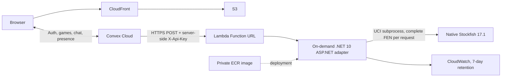

# On-demand Stockfish engine on AWS Lambda

Implementation status (2026-10-09): the .NET 10 adapter, native engine packaging, infrastructure, deployment workflow, and tests are implemented. Production still uses Lightsail. No AWS resources or Convex production settings were changed. Local Docker Desktop fails during startup; Linux container and AWS verification remain pending. AWS profile `shawnmdev` has no credentials.

## Architecture and resources



Only the vs-computer endpoint moves. S3, CloudFront, Route 53, HTTPS, Convex authentication, database, realtime multiplayer, chat, and presence retain their existing deployment. Stockfish still searches on the server and retains skill levels 0–20; the existing game UI's difficulty values continue working.

Two small CloudFormation stacks in `infra/engine-lambda` create these resources in **us-east-1**:

| Stack | Resource | Configuration |
| --- | --- | --- |
| `chess-lobby-engine-lambda-ecr` | Private ECR repository | AES256 encryption, basic scan on push, immutable `release-*` tags; only `keep-*` pins are mutable |
| ECR stack | Repository policy | Lambda service may pull only for this account/region's `chess-lobby-engine-*` functions |
| ECR stack | Lifecycle policy | Protect two rotating current/rollback pins, retain three recent release candidates, expire untagged images after one day |
| `chess-lobby-engine-lambda` | Lambda function | Image pinned by digest, x86_64, 2,048 MiB memory, 512 MiB temporary storage, 10-second timeout, reserved concurrency 2 |
| Function stack | Function URL | Buffered HTTP API v2 payloads, HTTPS, `AuthType: NONE`, no CORS configuration |
| Function stack | Two Lambda resource permissions | Public Function URL invocation; underlying `InvokeFunction` grant restricted to URL calls |
| Function stack | Execution IAM role | Trusts Lambda; attached policy permits only creating streams and writing events in the engine log group |
| Function stack | IAM managed policy | Scoped CloudWatch logging permissions; no AWS database, secret-store, or network permissions |
| Function stack | CloudWatch log group | Seven-day retention; retained when its stack is deleted |

There is no provisioned concurrency, keepalive schedule, VPC, NAT gateway, load balancer, or idle server. Reserved concurrency **caps** concurrent work; it does not keep environments running. Account-wide concurrency quotas must leave room for AWS's required unreserved capacity; a very low new-account quota can block a reservation.

## Authentication and work limits

Convex's server-side `fetch` supplies the existing `X-Api-Key` header. `AWS_IAM` would require signed requests and AWS credentials inside Convex; this implementation uses an application key to preserve the current integration. AWS describes both required permissions for `NONE` Function URLs in its [Function URL access documentation](https://docs.aws.amazon.com/lambda/latest/dg/urls-auth.html).

Generate a random key or reuse the existing Lightsail key if it is sufficiently strong and at least 32 characters. Keep it in a password manager, Lambda configuration, the deployment runner's environment, and Convex's server environment. Never set a `VITE_*` variable for it. CloudFormation receives a constrained `NoEcho` parameter through a temporary file that is removed in `finally`; it is absent from templates, image layers, outputs, and shell arguments. Lambda encrypts environment variables at rest. Principals allowed to read/decrypt Lambda configuration can still access the key; `NoEcho` is not a secret vault.

The app requires a configured key at startup and compares hashes in constant time **before** parsing a move request or starting Stockfish. `/health` remains a lightweight public liveness endpoint; it does not start Stockfish. No permissive browser CORS policy is enabled. An invalid-key request can still invoke Lambda and incur a small charge: the key prevents engine access, and concurrency bounds simultaneous work, but neither is an absolute spending limit. If needed, stop all work by setting reserved concurrency to zero.

- Request body limit: 4 KiB, including under the Lambda adapter.
- FEN: six fields, structurally valid board with one king per side, no adjacent kings or pawns on promotion ranks, no newlines/UCI injection. Convex remains the legal-position authority.
- Stockfish: one thread, 32 MiB hash, skill clamped to 0–20, thinking time clamped to 100–1,500 ms. Existing requests still ask for 800 ms.
- App deadline: five seconds including startup, UCI handshake and semaphore wait. Failed/cancelled searches kill the subprocess; EOF is an error, not a busy loop. Next request starts a clean process.
- Lambda deadline: ten seconds. Convex fetch deadline: fifteen seconds including cold-start headroom. Error responses avoid exposing process details.
- Every request issues `ucinewgame` and a complete FEN. Warm environments reuse the native process without sharing another game's position. There is no requirement to keep a particular environment alive.

The HTTP contract stays `POST /api/best-move` with `{ "fen": "...", "skill": 10, "movetimeMs": 800 }` and `{ "bestMove": "e7e5" }`. Convex now trims trailing slashes, bounds the fetch, and checks that external output is a legal move before applying it. The existing minimax fallback remains available for timeouts, throttling, bad output, and service failures.

## Runtime and Stockfish packaging

The ASP.NET app uses `Amazon.Lambda.AspNetCoreServer.Hosting` with `LambdaEventSource.HttpApi`; the handler is the assembly name `ChessEngine`. The same application still runs with Kestrel locally or in the ordinary HTTP Dockerfile. The Lambda image uses AWS's .NET 10 Amazon Linux 2023 base. [.NET 8 and 9 base images deprecate November 10, 2026; .NET 10 is listed through November 14, 2028](https://docs.aws.amazon.com/lambda/latest/dg/csharp-image.html), so this new deployment targets .NET 10. Container runtimes are updated by rebuilding and deploying a new image, not by leaving an old digest indefinitely.

`Dockerfile.lambda` compiles Stockfish 17.1 from commit `03e27488f3d21d8ff4dbf3065603afa21dbd0ef3` on Amazon Linux 2023 using portable `ARCH=x86-64`. It does not assume AVX2/BMI2 instructions or use an Ubuntu binary with different native dependencies. The final runtime installs `libstdc++`. Build and deployment explicitly select `linux/amd64` and disable Buildx provenance to produce a single-architecture Lambda-compatible image.

Stockfish is GPLv3. The image includes its license, exact source archive, and the two NNUE files used for compilation under `/opt/licenses/stockfish`. The documented build command, source commit, and build scripts provide reproducible corresponding-source context. If distributing the image/binary, distribute that corresponding source and license with it. See [Stockfish's repository](https://github.com/official-stockfish/Stockfish) and `Copying.txt`. To extract the bundle for distribution:

```powershell
docker create --name chess-engine-license chess-engine-lambda:test
docker cp chess-engine-license:/opt/licenses/stockfish ./stockfish-source.local
docker rm chess-engine-license
```

## Validation before deployment

Requirements: Node 22+, .NET 10 SDK, AWS CLI v2, PowerShell 7 for CI, Docker with a running Linux engine. Do not run Docker commands until its desktop issue is deliberately resolved; GitHub's Linux runner can perform the container checks independently.

```powershell
npm ci
dotnet test tests/ChessEngine.Tests/ChessEngine.Tests.csproj -c Release
node --experimental-strip-types --test tests/computer-engine.test.mjs
pwsh -NoProfile -File tests/deploy-engine-lambda.tests.ps1
npx tsc --noEmit -p convex/tsconfig.json
npm run build:web
```

The PowerShell test harness mocks every AWS, Docker, and Node command: it verifies deployment sequencing, secret-file cleanup, no-op updates, failed smoke checks, and the absence of cutover/retirement actions. It creates no resources and starts no Docker processes.

Docker-free native/adapter check, with a Stockfish binary for the local OS:

```powershell
dotnet publish apps/chess-engine/ChessEngine.csproj -c Release -o engine-publish.local
$env:STOCKFISH_PATH = 'C:/absolute/path/stockfish.exe'
node scripts/test-engine-runtime.mjs --assembly engine-publish.local/ChessEngine.dll
```

This starts the actual .NET Lambda runtime client against a local Runtime API stub and tests Function URL-shaped events with native Stockfish. It does not prove the Linux image works. Local results on Windows: 12 .NET tests passed, the Linux subprocess fixture skipped; six Convex integration tests passed; native adapter check passed legal moves, skill extremes, search clamping, authentication, malformed/oversized input, mate-in-one, and a 12-ply game sequence. First request was approximately 1,690 ms and warm request 810 ms on this machine, including 800 ms requested search. These are not AWS cold-start or billed-duration measurements. Web build and Convex TypeScript checks passed. Both templates passed AWS IaC MCP schema and bundled security validation with no findings.

Required remaining Linux check, once a Linux Docker environment is available:

```powershell
docker buildx build --platform linux/amd64 --provenance=false --load -f apps/chess-engine/Dockerfile.lambda -t chess-engine-lambda:test .
node scripts/test-engine-lambda.mjs --image chess-engine-lambda:test
```

The container test uses AWS's Runtime Interface Emulator with the actual native binary, an unprivileged user, read-only root, writable `/tmp`, and 2 GiB memory. It additionally tests process crash recovery, pause/resume, architecture, source packaging, and reports uncompressed image size. The Linux .NET fixture checks cancellation/exit recovery and that UCI receives search/thread/hash limits. CI runs both checks and `cfn-lint` on each PR.

## Deploy the replacement without cutting over

Authenticate using the project's `shawnmdev` AWS profile, then verify:

```powershell
aws sts get-caller-identity --profile shawnmdev --region us-east-1
```

The deployer needs CloudFormation change-set/create/update/read/wait permissions for the two engine stacks; ECR create/configure/lifecycle/policy/tag/push/read permissions for the engine repository; Lambda create/update/read/delete/URL/permission/concurrency operations on the named function; CloudWatch log-group create/read/retention/tag permissions for its log group; and IAM role/managed-policy create/read/update/delete/attach/tag permissions for the generated engine role/policy plus `iam:PassRole` limited to that role and `lambda.amazonaws.com`. ECR `GetAuthorizationToken` requires `Resource: *`. The runtime role itself only has logging permissions. Do not use an administrator runtime role.

The default stack/function name must begin `chess-lobby-engine-` to match the repository pull policy. Templates are deliberately restricted to us-east-1. Secrets in these snippets are placeholders; capture existing key values into variables without printing them.

```powershell
# Prefer reusing the current strong production key to simplify rollback.
$env:ENGINE_API_KEY = 'your-existing-strong-key-from-secure-storage'
./scripts/deploy-engine-lambda.ps1 -Profile shawnmdev
```

The script checks identity, builds and validates the Linux image before creating resources, deploys the repository stack, pushes a unique immutable release tag, resolves the image digest, and deploys the function stack. It protects the active and previous image with rotating `keep-current`/`keep-rollback` tags so failed future candidate builds cannot expire the active image. It runs the endpoint smoke test and prints the Function URL, digest, and ECR **compressed** size. It never invokes Convex or Lightsail commands. CloudFormation's account-specific change-set validation and all live endpoint checks remain untested until authenticated deployment.

On failure, inspect the specific operation and validation events before retrying:

```powershell
aws cloudformation describe-events --stack-name chess-lobby-engine-lambda --filters FailedEvents=true --profile shawnmdev --region us-east-1
```

The new **Deploy engine Lambda** GitHub workflow calls the same script and is manual, independent of the website/Convex workflow. Set up the `engine-lambda` GitHub environment with `ENGINE_AWS_ROLE_ARN` and `ENGINE_API_KEY`. Configure the deployment role's OIDC trust for `repo:OWNER/REPO:environment:engine-lambda`, audience `sts.amazonaws.com`, and the permissions above. Optional environment reviewers can gate deployment. Workflow concurrency serializes releases; it never cuts production over.

## Cutover, gameplay verification, and rollback

1. Keep Lightsail running. Record the existing production engine URL and key in secure storage. Deploy Lambda and pass its direct endpoint smoke test.
2. Deploy the small Convex fetch improvements with the existing Convex deployment workflow. They also work with Lightsail, so this can occur before cutover.
3. Capture the printed Function URL and test it again with the production key:

   ```powershell
   $env:ENGINE_API_URL = 'https://your-function.lambda-url.us-east-1.on.aws'
   node scripts/test-engine-lambda.mjs --url $env:ENGINE_API_URL
   ```

4. After those checks pass and cutover is approved, set the production Convex variables using `scripts/setup-convex-engine.ps1`. Reusing the existing key avoids a mismatch during sequential environment updates. If rotating keys, preserve both old values securely for rollback.
5. Play a production computer game at low and high difficulty, including several moves from an idle start, and confirm no fallback/error logs. Test a human multiplayer match and chat. Direct Lambda tests alone do not prove production is using Stockfish because Convex can fall back silently.
6. Inspect Lambda's CloudWatch `REPORT` records for init duration, billed duration, maximum memory, and errors; record ECR compressed storage. Repeat after an idle interval and a simultaneous second game. Verify that cold starts remain acceptable.
7. Keep the old service available through verification. Only after approval of the completed cutover and rollback evidence should Lightsail be retired.

Rollback **before** retirement: restore the recorded old URL and old key via `scripts/setup-convex-engine.ps1`; verify another game. Leave Lambda for investigation. For an image rollback, change CloudFormation's `ImageUri` to the previous digest protected by `keep-rollback`, preserve `EngineApiKey`, and deploy the stack through a change set. A direct `update-function-code` would create stack drift; reconcile any emergency update afterward.

Emergency stop of Lambda (does not affect multiplayer; vs-computer falls back):

```powershell
aws lambda put-function-concurrency --function-name chess-lobby-engine-lambda --reserved-concurrent-executions 0 --profile shawnmdev --region us-east-1
```

Restore concurrency to 2 when appropriate, and reconcile the CloudFormation `ReservedConcurrency` parameter if changed outside the stack.

Retirement is intentionally a separate operator action. Review and securely record the Lightsail image/deployment configuration, endpoint, key, service name, power and scale; make sure the image/source remains available to rebuild it. Stopping/disabling service alone does not establish that the fixed service charge has ended. Once the new production game path is verified and retirement is approved:

```powershell
# Destructive: run only after the verified/approved cutover, never as part of deployment.
aws lightsail delete-container-service --service-name chess-lobby-engine --profile shawnmdev --region us-east-1
```

Confirm the service has been removed and check later billing. After deletion, rollback to Lightsail requires recreating it from the saved configuration; the old endpoint may change. The deployment script never performs this command. To remove the Lambda replacement, delete its function stack; its log group and ECR repository are retained and must be reviewed separately if full cleanup is desired.

## Cost estimate and measurements still needed

Run `node scripts/estimate-engine-cost.mjs` to calculate the **engine-only** estimate. Defaults: ten games/month, sixty engine replies/game, two billed seconds/reply, 2 GiB Lambda memory, and 1 GiB retained ECR storage. At the published [Lambda on-demand rates](https://aws.amazon.com/lambda/pricing/) and [ECR storage rate](https://aws.amazon.com/ecr/pricing/), the script computes **$0.04000 compute + $0.00012 requests + $0.10 storage = $0.14012/month**, before free allowances, logs and transfer. It excludes existing site hosting, Convex, DNS and domain renewal and is not an audited bill.

Replace assumed duration and retained storage with actual AWS measurements, for example:

```powershell
node scripts/estimate-engine-cost.mjs --billed-seconds 3 --retained-ecr-gib 0.8
```

No Linux image size or AWS runtime has been measured here because Docker and AWS access are blocked. ECR charges reflect unique retained layers, not simply image count times uncompressed Docker size. Cleanup may take up to 24 hours; retain only the two documented `keep-*` pins so the protection rule works as intended. This removes the engine's always-running charge after Lightsail retirement, while retaining on-demand Stockfish strength and the live .NET component.
